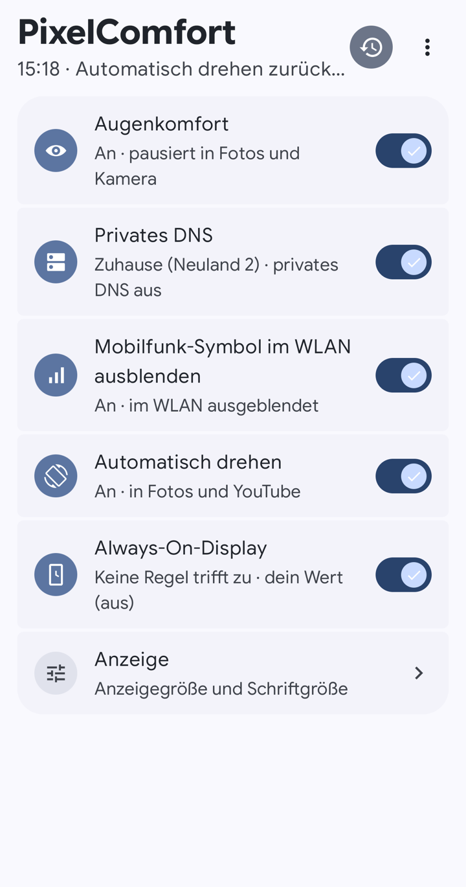
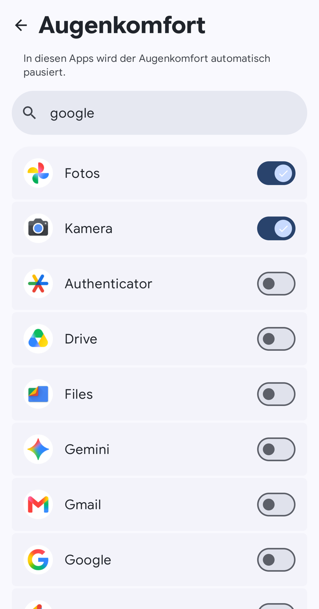
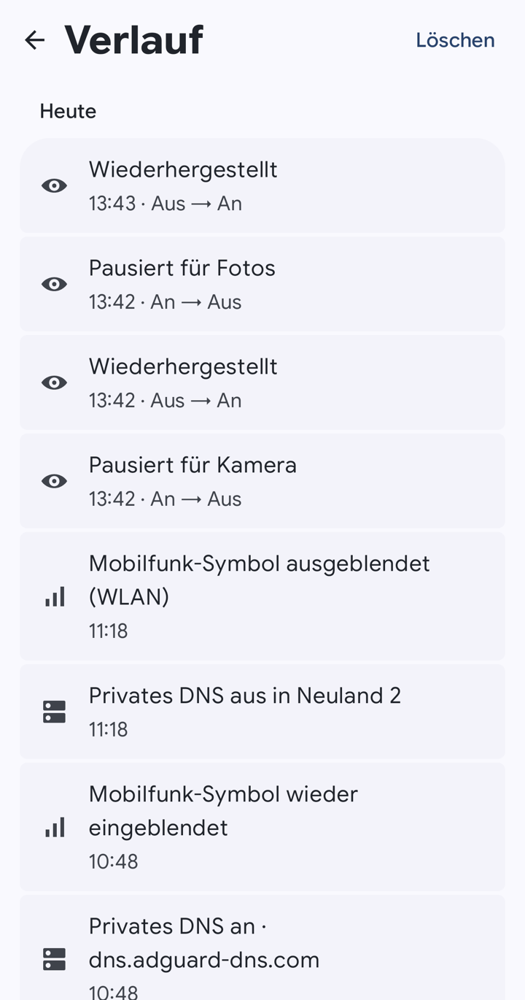

# 👁️ PixelComfort

[English](README.md) · **Deutsch**

**Schaltet den Augenkomfort-Modus (Comfort View) auf dem Google Pixel automatisch aus, sobald Kamera oder Google Fotos geöffnet werden – und stellt danach exakt den vorherigen Zustand wieder her.**

Dazu: privates DNS je nach WLAN, Mobilfunk-Symbol im WLAN ausblenden, automatisch drehen nur in gewählten Apps, Always-On-Display je nach Bluetooth-Gerät oder WLAN, Anzeige- und Schriftgröße sowie Schnelleinstellungs-Kacheln für Augenkomfort, Drehen und NFC.

-3DDC84?logo=android&logoColor=white)


[](https://github.com/WEITERFUNKEN-Thomas/pixelcomfort/releases/latest)
[](https://f-droid.org/packages/com.noirdraco.pixelcomfort/)

---

## 🤔 Warum?

Der mit dem **Pixel Drop (März 2026)** eingeführte *Comfort-Filter* („Augenkomfort-Modus", Einstellungen → Display & Touch → Komfort-Filter) gibt dem Display eine wärmere, pastellige Optik – super für die Augen, aber **furchtbar beim Fotografieren**: Sucherbild und Fotos-Vorschau wirken farbstichig.

Google bietet dafür – anders als beim Nachtlicht – **keinen Zeitplan und keine öffentliche API**. PixelComfort löst das automatisch:

```
Kamera/Fotos öffnen  ──▶  Comfort View AUS
App verlassen        ──▶  vorheriger Zustand wiederhergestellt
```

Dabei wird **immer der echte System-Zustand respektiert**: Der aktuelle Wert wird live gelesen und gemerkt – war der Filter vorher aus, bleibt er aus. Andere Einstellungen (Dynamisch, Intensität) werden nicht angetastet.

## ✨ Funktionen

Die Startseite ist eine Übersicht mit einer Karte pro Funktion: Der Schalter schaltet eine Funktion an oder aus, Antippen der Karte öffnet ihre Seite.

- **Augenkomfort** – pausiert den Filter in den gewählten Apps und stellt ihn danach wieder her; der Schalter auf der Karte schaltet den Filter von Hand
- **App-Auswahl** – Apps aus einer Liste mit Symbolen und Suche wählen
- **Privates DNS je nach WLAN** – im Heim-WLAN aus (damit z. B. AdGuard Home filtert), überall sonst an
- **Mobilfunk-Symbol im WLAN ausblenden** – blendet das Mobilfunk-Symbol in der Statusleiste aus, solange WLAN verbunden ist
- **Automatisch drehen** – die Anzeige dreht sich nur in den Apps, die du auswählst, überall sonst gilt die vorherige Einstellung
- **Always-On-Display** – Regeln schalten das Always-On-Display je nach verbundenem Bluetooth-Gerät oder WLAN an oder aus
- **Anzeige** – Regler für Anzeigegröße (kleinste Breite in dp) und Schriftgröße, mit **+**/**−** für feine Schritte und je einem *Standard*-Button
- **Schnelleinstellungs-Kacheln** – *Augenkomfort*, *Drehen in Apps* und *NFC*
- **Verlauf** – zeigt, was die App wann geschaltet hat und was schiefging
- **Shizuku-Warnung** – eine Benachrichtigung meldet, wenn Shizuku nicht läuft
- **Material You** – folgt den Systemfarben, hell und dunkel
- **Deutsch und Englisch** – folgt der Systemsprache, in den Systemeinstellungen pro App wählbar

## 📱 Screenshots

| Start | Apps | Verlauf |
|:---:|:---:|:---:|
|  |  |  |

## ⚙️ Wie es funktioniert

Der Schalter liegt als nicht-öffentlicher Key in den System-Settings – **per adb-Diff auf einem Pixel 10 Pro ermittelt**, nicht geraten:

| Einstellung | Namespace | Key | Werte |
|---|---|---|---|
| Augenkomfort-Modus | `system` | `cv_enabled` | `1` = an, `0` = aus |
| Dynamisch (Adaptiv) | `system` | `cv_dynamic_enabled` | wird **nicht** angefasst |
| Intensität | `system` | `cv_preferred_intensity` | wird **nicht** angefasst |

Drei Bausteine:

1. **AccessibilityService** – lauscht auf `TYPE_WINDOW_STATE_CHANGED` und erkennt, wann eine der gewählten Apps in den Vordergrund kommt oder verschwindet. Welche App wirklich vorn ist, kommt aus den Nutzungsdaten von Android (das letzte `ACTIVITY_RESUMED`), wenn der *Zugriff auf Nutzungsdaten* erteilt ist – Fenster-Ereignisse allein können täuschen (manche Apps melden nach dem Verlassen noch ein spätes Fenster). Ohne den Zugriff entscheidet eine Heuristik. Die Netz-Überwachung (privates DNS, Mobilfunk-Symbol) und die Always-On-Display-Regeln laufen im selben Dienst mit – ein eigener Vordergrunddienst mit Dauer-Benachrichtigung ist nicht nötig.
2. **SettingWriter** – versucht zuerst den `ContentResolver`; da `cv_enabled` ein `@hide`-Key ist, den Fremd-Apps weder lesen noch schreiben dürfen (auch nicht mit `WRITE_SECURE_SETTINGS`!), greift automatisch der Fallback …
3. **Shizuku** – führt `settings get/put system cv_enabled …` mit ADB-Shell-Rechten aus. **Kein Root nötig.** Alle Aufrufe laufen auf einem seriellen Hintergrund-Thread.

Die Automatik ist bewusst vorsichtig:

- Ist der Wert **nicht lesbar** (Shizuku läuft nicht), wird gar nicht pausiert – ein geratener Wert würde später falsch „wiederhergestellt".
- War der Filter **schon aus**, wird nichts geschrieben.
- **Scheitert das Wiederherstellen**, bleibt der Wert gemerkt und der nächste App-Wechsel versucht es erneut.

### Was braucht Shizuku?

`WRITE_SECURE_SETTINGS` und „Systemeinstellungen ändern" (`WRITE_SETTINGS`) werden einmalig per Shizuku erteilt und bleiben danach erhalten. Funktionen, die nur diese Rechte brauchen, laufen auch weiter, wenn Shizuku nicht läuft.

| Funktion | Einstellung | Braucht |
|---|---|---|
| Augenkomfort | `system/cv_enabled` | **Shizuku** (Lesen und Schreiben) |
| Anzeigegröße | `wm density` | **Shizuku** |
| Schriftgröße | `system/font_scale` | `WRITE_SETTINGS`, sonst Shizuku |
| Privates DNS je nach WLAN | `global/private_dns_mode`, `private_dns_specifier` | `WRITE_SECURE_SETTINGS` |
| Mobilfunk-Symbol im WLAN ausblenden | `secure/icon_blacklist` | `WRITE_SECURE_SETTINGS` zum Schreiben; Lesen der Liste meist nur per **Shizuku** |
| Automatisch drehen | `system/accelerometer_rotation` | `WRITE_SETTINGS` |
| Always-On-Display | `secure/doze_always_on` | `WRITE_SECURE_SETTINGS` |
| NFC-Kachel | `svc nfc` | **Shizuku** (ab Android 16 zuerst die offizielle API) |
| Welche App vorn ist (Augenkomfort, Drehen) | Nutzungsdaten | *Zugriff auf Nutzungsdaten* (`GET_USAGE_STATS`), freiwillig – ohne entscheidet eine Heuristik |

Privates DNS, Mobilfunk-Symbol, automatisches Drehen und die Always-On-Display-Regeln brauchen außerdem die eingeschaltete Bedienungshilfe.

## 🌐 Privates DNS je nach WLAN

Hat dein Heimnetz einen eigenen DNS-Filter (z. B. **AdGuard Home** oder Pi-hole), umgeht ein am Handy eingetragenes privates DNS ihn zu Hause. PixelComfort schaltet das für dich:

```
Heim-WLAN        ──▶  privates DNS aus  (das DNS deines Heimnetzes greift)
überall sonst    ──▶  privates DNS an   (z. B. dns.adguard-dns.com)
```

| Einstellung | Namespace | Key | Werte |
|---|---|---|---|
| Modus privates DNS | `global` | `private_dns_mode` | `off` zu Hause, sonst `hostname` |
| Name privates DNS | `global` | `private_dns_specifier` | dein DNS-Name |

- **Stromsparend**: kein Abfragen, kein Timer. Android meldet jeden Wechsel des aktiven Netzes von selbst (`registerDefaultNetworkCallback`), die App reagiert nur.
- **Zuhause nur, wenn gesichert**: ein WLAN aus deiner Liste, das mit Passwort geschützt ist (WPA2/WPA3/Enterprise). Offene und OWE-Netze zählen nie – so eins könnte jeder mit gleichem Namen aufmachen.
- **Im Zweifel bleibt privates DNS an**: kein Netz, fremdes WLAN, WLAN-Name nicht lesbar (Standort aus) – alles gilt als unterwegs.
- **Nichts bleibt ausgeschaltet zurück**: Schaltest du die Automatik oder die Bedienungshilfe ab, wird privates DNS sofort wieder eingetragen.
- **Kein Shizuku zum Schalten nötig**: Die Keys sind öffentlich; mit `WRITE_SECURE_SETTINGS` (einmalig per Shizuku erteilt) schreibt die App sie direkt.
- Kann privates DNS unterwegs **nicht eingeschaltet** werden, meldet das eine Benachrichtigung.
- DNS-Namen in den Android-Einstellungen geändert? Die App übernimmt ihn, sobald du wieder zu Hause bist.

Einrichten über die Karte **Privates DNS**: Standort-Berechtigung erlauben (*Bei Nutzung der App* reicht – Android gibt den WLAN-Namen nur damit heraus, der Standort selbst wird nie benutzt), zu Hause auf *Aktuelles WLAN hinzufügen* tippen, DNS-Namen prüfen, *Automatik* einschalten. Was noch fehlt (Bedienungshilfe, Standort, `WRITE_SECURE_SETTINGS`), steht oben auf der Seite – Antippen der Zeile führt zur Lösung.

> 💡 Verteilt dein Router neben AdGuard Home noch einen zweiten DNS-Server (z. B. `9.9.9.9`), kann das Handy zu Hause trotzdem ab und zu am Filter vorbei fragen. Im Router nur AdGuard Home als DNS eintragen.

Notfall-Reset per adb:

```bash
adb shell settings put global private_dns_mode hostname
adb shell settings put global private_dns_specifier dns.adguard-dns.com
```

## 📶 Mobilfunk-Symbol im WLAN ausblenden

Solange WLAN verbunden ist, verschwindet das Mobilfunk-Symbol (Balken und 4G/5G) aus der Statusleiste; ohne WLAN kommt es zurück. Die Karte hat keine eigene Seite – Antippen der Karte oder des Schalters schaltet die Funktion an oder aus.

- Die System-UI blendet jedes Symbol aus, das in `secure/icon_blacklist` steht (kommagetrennt). PixelComfort fügt nur den eigenen Eintrag `mobile` hinzu oder entfernt ihn – alle anderen Einträge bleiben.
- Ist die Liste **nicht lesbar**, wird nichts geschrieben – so können keine anderen Einträge verloren gehen.
- Schaltest du die Funktion oder die Bedienungshilfe ab, wird das Symbol sofort wieder eingeblendet.

## 🔄 Automatisch drehen in Apps

Die Anzeige dreht sich nur in den Apps, die du auswählst, mit dem Handy (`system/accelerometer_rotation` = `1`), überall sonst gilt die vorherige Einstellung. Der Schalter auf der Karte **Automatisch drehen** schaltet die Funktion ein, Antippen der Karte öffnet die App-Liste (sie startet leer).

- Gleiche Regeln wie beim Augenkomfort: Der vorherige Wert wird gemerkt und beim Verlassen der App wiederhergestellt.
- Schaltest du in einer dieser Apps selbst um, bleibt es bei deiner Wahl.
- Schaltest du die Funktion ab, während eine der Apps vorn ist, wird sofort zurückgestellt.
- Die Kachel **Drehen in Apps** schaltet die Funktion an oder aus – nicht die Android-Einstellung „Automatisch drehen" selbst.

## 🌙 Always-On-Display je nach Bluetooth oder WLAN

Regeln schalten das Always-On-Display (`secure/doze_always_on`) je nach verbundenem Bluetooth-Gerät oder WLAN. Über die Karte **Always-On-Display** Regeln anlegen: gekoppeltes Bluetooth-Gerät oder WLAN-Namen wählen, dann *Always-On-Display an* oder *aus*.

- **Die oberste zutreffende Regel gewinnt**; zum Sortieren am Griff ziehen. Jede Regel lässt sich einzeln abschalten.
- **Trifft keine Regel zu**, gilt dein eigener Wert.
- **Von Hand umgeschaltet?** Das bleibt so, bis sich ein Gerät oder WLAN aus deinen Regeln verbindet oder trennt.
- **Nur ereignisgesteuert**: Bluetooth-Verbindungs-Ereignisse und WLAN-Wechsel – es wird nie gescannt.
- Schaltest du die Automatik oder die Bedienungshilfe ab, kommt dein eigener Wert zurück.
- Berechtigungen: `BLUETOOTH_CONNECT` für Bluetooth-Regeln, Standort für WLAN-Regeln (nur zum Lesen des WLAN-Namens) und `WRITE_SECURE_SETTINGS` zum Schalten.
- Die Regeln sind **nicht im Backup** enthalten.

## 🖥️ Anzeigegröße und Schriftgröße

Über die Karte **Anzeige**. Beide Regler schreiben beim Loslassen. **+** und **−** ändern die Anzeigegröße um den nächsten einstellbaren dp-Wert und die Schrift um 0,05; übernommen wird kurz nach dem letzten Tipp. Die Anzeigegröße läuft über `wm density` per Shizuku, die Schriftgröße über den öffentlichen Key `system/font_scale`. Die Bereiche sind bewusst begrenzt (320–600 dp, 0,85–2,00), damit das Gerät immer bedienbar bleibt.

Notfall-Reset per adb:

```bash
adb shell wm density reset
adb shell settings put system font_scale 1.0
```

## 🎛️ Schnelleinstellungs-Kacheln

Hinzufügen in der App unter **⋮ → Kachel „…" hinzufügen** oder in den Schnelleinstellungen über das Stift-Symbol.

- **Augenkomfort** – schaltet den Filter von Hand um und zeigt den Live-Zustand. Ohne laufendes Shizuku ist sie *nicht verfügbar* (ausgegraut).
- **Drehen in Apps** – schaltet automatisches Drehen in Apps an oder aus; die Unterzeile zeigt die App oder die Anzahl der Apps.
- **NFC** – schaltet NFC an und aus. Ab Android 16 versucht die App zuerst die offizielle API, sonst (oder wenn Android ablehnt) `svc nfc` über Shizuku. Secure NFC wird nie umgeschaltet, nur angezeigt (*An · Sicher*). Langes Drücken auf die Kachel öffnet die NFC-Einstellungen von Android.

Augenkomfort-Kachel, Schalter auf der Karte und Automatik teilen sich eine Warteschlange – sie können sich also nicht überholen. Schaltest du **während** eine gewählte App vorn ist von Hand um, gilt deine Entscheidung auch nach dem Verlassen der App.

## 🚀 Einrichtung

Voraussetzungen: Android 13 oder neuer, [Shizuku](https://shizuku.rikka.app/) installiert und gestartet. Der Augenkomfort selbst braucht ein Pixel mit Comfort-Filter.

1. **App installieren**: über [F-Droid](https://f-droid.org/packages/com.noirdraco.pixelcomfort/) oder als [neuestes APK aus den Releases](https://github.com/WEITERFUNKEN-Thomas/pixelcomfort/releases/latest) (oder selbst bauen, siehe unten) und öffnen
2. Unter **Einrichtung** auf **Shizuku** tippen → im Shizuku-Dialog *Immer zulassen*
3. Auf **Bedienungshilfe** tippen → *PixelComfort Auto-Aus* einschalten
4. Auf **Benachrichtigungen** tippen und erlauben, damit die App warnt, wenn Shizuku nicht läuft
5. Für privates DNS, Mobilfunk-Symbol, automatisches Drehen und Always-On-Display: **⋮ → Erweitert → Berechtigungen**, auf *Sichere Einstellungen ändern* tippen – das erteilt `WRITE_SECURE_SETTINGS`, `WRITE_SETTINGS` und den Zugriff auf Nutzungsdaten einmalig per Shizuku. Solange der Zugriff auf Nutzungsdaten fehlt, bietet ihn oben auf der Startseite eine Karte an (mit Shizuku per Tipp, sonst über die Android-Einstellungen)
6. Optional: Karte **Augenkomfort** antippen für andere Apps; die übrigen Funktionen mit ihrem Schalter einschalten und über ihre Karte einrichten; **⋮ → Kachel „…" hinzufügen** für die Kacheln

Ist alles erledigt, verschwindet die Einrichtung, und unter dem Titel steht *Alles eingerichtet* oder der letzte Eintrag aus dem Verlauf.

> ⚠️ **Nach jedem Neustart** muss Shizuku wieder laufen (bei kabellosem Debugging kann es automatisch starten).

## 🔨 Bauen

```bash
# Debug
./gradlew :app:assembleDebug

# Signiertes Release (benötigt keystore.properties + eigenen Keystore, siehe unten)
./gradlew :app:assembleRelease

# Unit-Tests
./gradlew :app:testDebugUnitTest
```

Für Release-Builds eine `keystore.properties` im Projekt-Root anlegen (liegt in `.gitignore`):

```properties
storeFile=mein-release.jks
storePassword=…
keyAlias=…
keyPassword=…
```

Fehlt die Datei, wird das Release einfach unsigniert gebaut.

Das Release wird mit R8 optimiert und bringt ein Baseline-Profil mit. Das eingecheckte Profil liegt in `app/src/release/generated/baselineProfiles/`, ein normaler Build braucht also kein Gerät. Neu erzeugen mit angeschlossenem Gerät:

```bash
./gradlew :app:generateReleaseBaselineProfile
```

Die Mess-Variante (Modul `:macrobenchmark`) läuft unter eigener App-ID – eine installierte PixelComfort samt Einstellungen bleibt unberührt.

**Stack:** Kotlin 2.4.10 · Jetpack Compose (BOM 2026.08.00, Material 3 1.5.0-alpha29) · DataStore 1.2.1 · kotlinx.serialization 1.11.0 · Shizuku API 13.1.5 · AGP 9.3.1 · Gradle 9.7.1 · targetSdk 37 · R8 und Baseline-Profil

## 🔍 Debugging

Die App loggt jede Aktion unter dem Tag `PixelComfort`:

```bash
adb logcat -s 'PixelComfort:*'
# z. B.:
# Ziel-App 'com.google.android.GoogleCamera' -> system/cv_enabled AUS (gemerkt=1) ok=true via SHIZUKU: …
# Drehen: 'com.google.android.youtube' -> accelerometer_rotation=1 (gemerkt=0) ok=true via CONTENT_RESOLVER: …
```

Falls der Key auf deinem Gerät anders heißt – selbst finden per Diff:

```bash
adb shell settings list system > vorher.txt
#  … Comfort-Filter in den Einstellungen umschalten …
adb shell settings list system > nachher.txt
diff vorher.txt nachher.txt
```

Namespace, Key und Werte lassen sich in der App unter **⋮ → Erweitert** anpassen.

## ⚠️ Einschränkungen

- **Shizuku muss laufen** für Augenkomfort, Anzeigegröße und die NFC-Kachel – ohne Shizuku kann der Key `cv_enabled` nicht geschrieben werden (er ist für Fremd-Apps gesperrt).
- **Advanced Protection Mode**: Android 17 deaktiviert damit Bedienungshilfen, die keine echten Barrierefreiheits-Tools sind. Die App erkennt das und meldet es unter Einrichtung.
- Wird die **Bedienungshilfe deaktiviert, während** eine gewählte App offen ist, bleibt der Augenkomfort aus. Schalter auf der Karte, Kachel oder Systemeinstellung nutzen. Privates DNS, Mobilfunk-Symbol, Drehen und Always-On-Display werden in dem Fall zurückgestellt.
- **Privates DNS, Mobilfunk-Symbol, automatisches Drehen und Always-On-Display-Regeln** wirken nur, solange die Bedienungshilfe aktiv ist.
- **Privates DNS je nach WLAN** braucht die Standort-Berechtigung und eingeschalteten Standort – sonst ist der WLAN-Name nicht lesbar und privates DNS bleibt einfach auch zu Hause an.
- **WLAN-Regeln fürs Always-On-Display** prüfen nur den WLAN-Namen – anders als beim Heim-WLAN fürs private DNS zählen auch offene Netze.
- **Vor dem Deinstallieren unterwegs sein** (oder die DNS-Automatik ausschalten): Wird die App im Heim-WLAN entfernt, bleibt privates DNS aus – auch später unterwegs. Android gibt einer App beim Deinstallieren keine Gelegenheit mehr, es wieder einzutragen. Dann von Hand unter *Einstellungen → Netzwerk & Internet → Privates DNS* einschalten. Aus demselben Grund vor dem Deinstallieren *Mobilfunk-Symbol im WLAN ausblenden* abschalten, sonst bleibt das Symbol ausgeblendet.
- **Nicht jeder dp-Wert ist erreichbar**: Android speichert die Dichte in ganzen dpi, oberhalb von etwa 450 dp springt die Anzeigegröße deshalb in Schritten von 1–2 dp (**+**/**−** überspringen solche Werte).
- Im kompakten Kachel-Layout des Pixel zeigt Android **nur das Icon** – Label und Untertitel erscheinen erst im Bearbeiten-Screen der Schnelleinstellungen.
- Getestet auf **Pixel 10 Pro mit Android 17** – der `cv_*`-Key existiert vermutlich nur auf Pixel-Geräten mit dem Comfort-Filter-Feature (`com.android.pixeldisplayservice`).

## 📄 Rechtliches

**Nutzung auf eigene Gefahr.** Die App ändert Systemeinstellungen über Shizuku, `WRITE_SECURE_SETTINGS` und `WRITE_SETTINGS`. Falsche Werte unter *Erweitert* oder eine extreme Anzeigegröße können das Gerät schwer bedienbar machen – `adb shell wm density reset` und `adb shell settings put system font_scale 1.0` machen die Anzeige-Änderungen rückgängig.

Die App hat keine Internet-Berechtigung. Der Zugriff auf Nutzungsdaten dient nur dazu, zu sehen, welche App vorn ist; gespeichert wird nichts.

Privates Hobby-Projekt, ohne Gewähr. Kein offizielles Google-Produkt. „Pixel" ist eine Marke von Google LLC.

Lizenz: [MIT](LICENSE).
