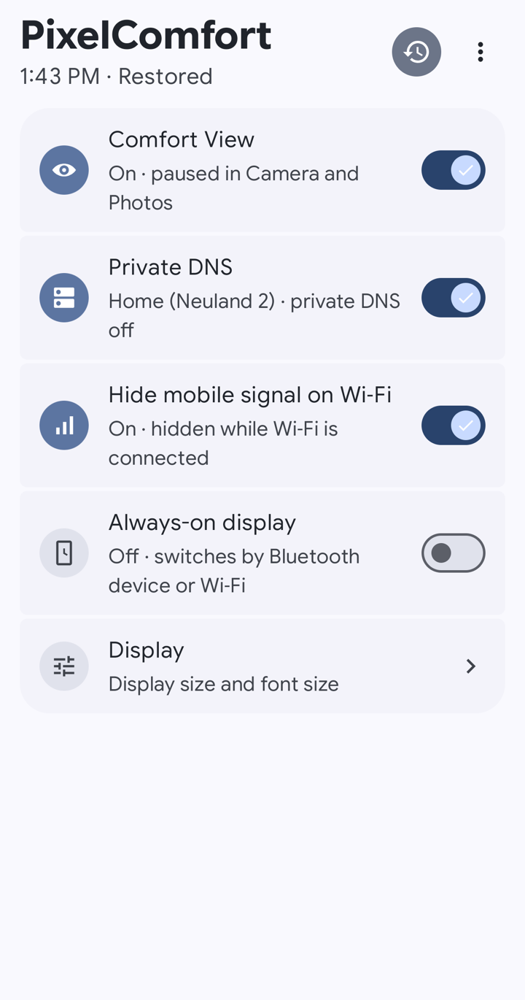
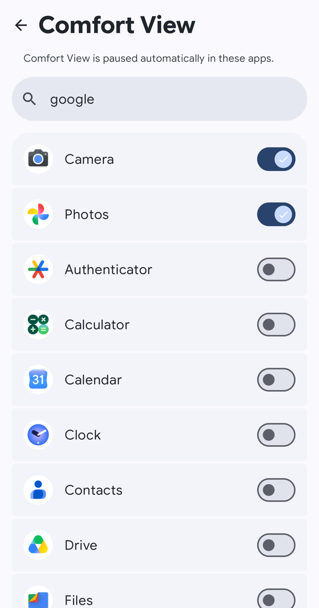
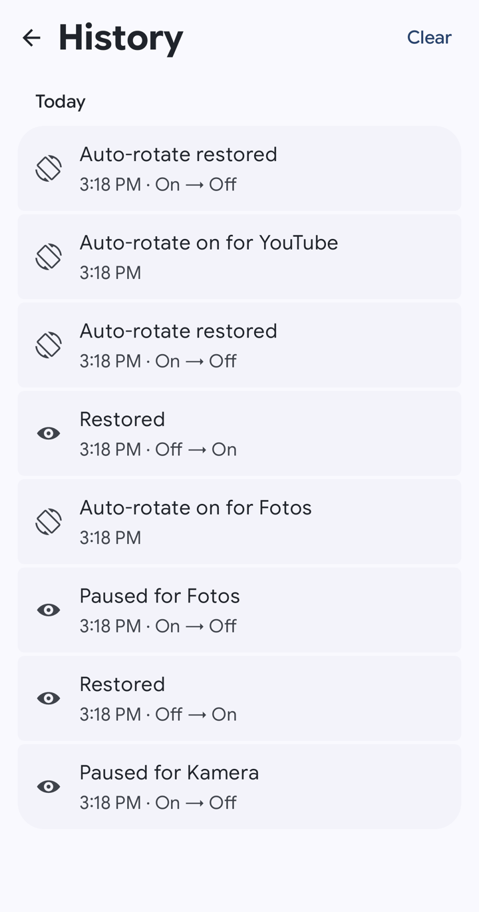

# 👁️ PixelComfort

**English** · [Deutsch](README.de.md)

**Turns Comfort View off automatically on Google Pixel as soon as you open the camera or Google Photos – and restores exactly the previous state when you leave.**

On top of that: private DNS by Wi‑Fi, mobile signal icon hidden on Wi‑Fi, auto-rotate only in the apps you choose, always-on display by Bluetooth device or Wi‑Fi, display and font size, and Quick Settings tiles for Comfort View, rotation and NFC.

-3DDC84?logo=android&logoColor=white)


[](https://github.com/WEITERFUNKEN-Thomas/pixelcomfort/releases/latest)
[](https://f-droid.org/packages/com.noirdraco.pixelcomfort/)

---

## 🤔 Why?

The *comfort filter* introduced with the **Pixel Drop of March 2026** (“Comfort View”, Settings → Display & touch → Comfort filters) gives the display a warmer, pastel look. That is easy on the eyes but **terrible for taking photos**: the viewfinder and the Photos preview get a colour cast.

Unlike Night Light, Google offers **no schedule and no public API** for it. PixelComfort handles it automatically:

```
Open camera / Photos  ──▶  Comfort View OFF
Leave the app         ──▶  previous state restored
```

The **real system state is always respected**: the current value is read live and remembered – if the filter was off before, it stays off. Other settings (dynamic, intensity) are never touched.

## ✨ Features

The home screen is an overview with one card per feature: the switch turns a feature on or off, tapping the card opens its page.

- **Comfort View** – pauses the filter in the apps you pick and restores it afterwards; the switch on the card turns the filter on or off by hand
- **App picker** – choose the apps from a list with icons and search
- **Private DNS by Wi‑Fi** – private DNS off on your home Wi‑Fi (so e.g. AdGuard Home filters), on everywhere else
- **Hide mobile signal on Wi‑Fi** – hides the mobile signal icon in the status bar while Wi‑Fi is connected
- **Auto-rotate** – the screen rotates only in the apps you choose, everywhere else it keeps its previous setting
- **Always-on display** – rules switch the always-on display on or off depending on a connected Bluetooth device or Wi‑Fi
- **Display** – sliders for display size (smallest width in dp) and font size, with **+**/**−** for fine steps and a *Default* button each
- **Quick Settings tiles** – *Comfort View*, *Rotate in apps* and *NFC*
- **History** – shows what the app switched, when, and what went wrong
- **Shizuku warning** – a notification tells you when Shizuku isn’t running
- **Material You** – follows your system colours, light and dark
- **English and German** – follows the system language, selectable per app in the system settings

## 📱 Screenshots

| Home | Apps | History |
|:---:|:---:|:---:|
|  |  |  |

## ⚙️ How it works

The switch is a non-public key in the system settings – **found with an adb diff on a Pixel 10 Pro**, not guessed:

| Setting | Namespace | Key | Values |
|---|---|---|---|
| Comfort View | `system` | `cv_enabled` | `1` = on, `0` = off |
| Dynamic (adaptive) | `system` | `cv_dynamic_enabled` | **not** touched |
| Intensity | `system` | `cv_preferred_intensity` | **not** touched |

Three building blocks:

1. **AccessibilityService** – listens for `TYPE_WINDOW_STATE_CHANGED` and detects when one of the selected apps comes to the foreground or leaves it. Which app is really in front comes from Android’s usage data (the last `ACTIVITY_RESUMED`) if *Usage access* is granted – window events alone can mislead (some apps send a late window after you left them). Without usage access, a heuristic decides. The network watcher (private DNS, mobile icon) and the always-on display rules run inside the same service, so no extra foreground service or permanent notification is needed.
2. **SettingWriter** – tries the `ContentResolver` first. Because `cv_enabled` is a `@hide` key that other apps may neither read nor write (not even with `WRITE_SECURE_SETTINGS`), it falls back automatically to …
3. **Shizuku** – runs `settings get/put system cv_enabled …` with ADB shell rights. **No root required.** All calls run on one serial background thread.

The automation is deliberately cautious:

- If the value **can’t be read** (Shizuku isn’t running), it does not pause at all – a guessed value would be “restored” wrongly later.
- If the filter **was already off**, nothing is written.
- If **restoring fails**, the value stays remembered and the next app switch tries again.

### What needs Shizuku?

`WRITE_SECURE_SETTINGS` and “Modify system settings” (`WRITE_SETTINGS`) are granted once via Shizuku and stay granted afterwards. Features that only need these keep working when Shizuku isn’t running.

| Feature | Setting | Needs |
|---|---|---|
| Comfort View | `system/cv_enabled` | **Shizuku** (reading and writing) |
| Display size | `wm density` | **Shizuku** |
| Font size | `system/font_scale` | `WRITE_SETTINGS`, otherwise Shizuku |
| Private DNS by Wi‑Fi | `global/private_dns_mode`, `private_dns_specifier` | `WRITE_SECURE_SETTINGS` |
| Hide mobile signal on Wi‑Fi | `secure/icon_blacklist` | `WRITE_SECURE_SETTINGS` for writing; reading the list usually needs **Shizuku** |
| Auto-rotate | `system/accelerometer_rotation` | `WRITE_SETTINGS` |
| Always-on display | `secure/doze_always_on` | `WRITE_SECURE_SETTINGS` |
| NFC tile | `svc nfc` | **Shizuku** (Android 16+ tries the official API first) |
| Which app is in front (Comfort View, auto-rotate) | usage data | *Usage access* (`GET_USAGE_STATS`), optional – without it a heuristic decides |

Private DNS, mobile icon, auto-rotate and the always-on display rules also need the accessibility service to be on.

## 🌐 Private DNS by Wi‑Fi

If your home network has its own DNS filter (e.g. **AdGuard Home** or Pi-hole), a private DNS entered on the phone bypasses it at home. PixelComfort switches it for you:

```
Home Wi‑Fi       ──▶  private DNS off  (the DNS of your home network is used)
anywhere else    ──▶  private DNS on   (e.g. dns.adguard-dns.com)
```

| Setting | Namespace | Key | Values |
|---|---|---|---|
| Private DNS mode | `global` | `private_dns_mode` | `off` at home, `hostname` elsewhere |
| Private DNS name | `global` | `private_dns_specifier` | your DNS name |

- **Power-saving**: no polling, no timer. Android reports every change of the default network by itself (`registerDefaultNetworkCallback`), the app only reacts.
- **Home only counts if secured**: a Wi‑Fi from your list that is protected by a password (WPA2/WPA3/Enterprise). Open and OWE networks never count – anyone could open one with the same name.
- **When in doubt, private DNS stays on**: no network, unknown Wi‑Fi, Wi‑Fi name not readable (location off) – all count as away.
- **Nothing is left switched off**: turning the automation or the accessibility service off enters private DNS again right away.
- **No Shizuku needed for switching**: these keys are public; with `WRITE_SECURE_SETTINGS` (granted once via Shizuku) the app writes them directly.
- If private DNS **can’t be turned on** away from home, a notification tells you.
- Changed the DNS name in the Android settings? The app picks it up the next time you get home.

Set it up by tapping the **Private DNS** card: allow the location permission (*While using the app* is enough – Android only reveals the Wi‑Fi name with it, the location itself is never used), tap *Add current Wi‑Fi* at home, check the DNS name, turn on *Automation*. Anything still missing (accessibility service, location, `WRITE_SECURE_SETTINGS`) is listed at the top of the page – tap a line to fix it.

> 💡 If your router hands out a second DNS server next to AdGuard Home (e.g. `9.9.9.9`), the phone can still bypass the filter at home now and then. Enter only AdGuard Home as DNS in the router.

Emergency reset over adb:

```bash
adb shell settings put global private_dns_mode hostname
adb shell settings put global private_dns_specifier dns.adguard-dns.com
```

## 📶 Hide mobile signal on Wi‑Fi

While Wi‑Fi is connected, the mobile signal icon (bars and 4G/5G) disappears from the status bar; without Wi‑Fi it comes back. This card has no page of its own – tapping it or its switch turns the feature on or off.

- The System UI hides every icon listed in `secure/icon_blacklist` (comma-separated). PixelComfort only adds or removes its own entry `mobile` – all other entries stay.
- If the list **can’t be read**, nothing is written, so no other entries can get lost.
- Turning the feature or the accessibility service off shows the icon again right away.

## 🔄 Auto-rotate in apps

The screen rotates with your phone only in the apps you choose (`system/accelerometer_rotation` = `1`), everywhere else it keeps its previous setting. The switch on the **Auto-rotate** card turns the feature on, tapping the card opens the app list (it starts empty).

- Same rules as for Comfort View: the previous value is remembered and restored when you leave the app.
- If you switch rotation yourself while one of the apps is open, your choice stays.
- Turning the feature off restores the previous setting right away if one of the apps is in front.
- The tile **Rotate in apps** turns the feature on or off – not Android’s own auto-rotate setting.

## 🌙 Always-on display by Bluetooth or Wi‑Fi

Rules switch the always-on display (`secure/doze_always_on`) depending on a connected Bluetooth device or Wi‑Fi. Tap the **Always-on display** card to add rules: choose a paired Bluetooth device or a Wi‑Fi name, then *Always-on display on* or *off*.

- **The topmost matching rule wins**; drag the handle to reorder. Each rule can be switched off on its own.
- **If no rule matches**, your own setting applies.
- **Switched by hand?** That stays until a device or Wi‑Fi from your rules connects or disconnects.
- **Event-driven only**: Bluetooth connection events and Wi‑Fi changes – the app never scans.
- Turning the automation or the accessibility service off brings back your own setting.
- Permissions: `BLUETOOTH_CONNECT` for Bluetooth rules, location for Wi‑Fi rules (only to read the Wi‑Fi name), and `WRITE_SECURE_SETTINGS` for switching.
- The rules are **not included in backups**.

## 🖥️ Display size and font size

Tap the **Display** card. Both sliders write when you let go. **+** and **−** move display size to the next reachable dp value and font size by 0.05; the change is applied shortly after your last tap. Display size uses `wm density` through Shizuku, font size uses the public key `system/font_scale`. The ranges are limited on purpose (320–600 dp, 0.85–2.00) so the device always stays usable.

Emergency reset over adb:

```bash
adb shell wm density reset
adb shell settings put system font_scale 1.0
```

## 🎛️ Quick Settings tiles

Add a tile in the app under **⋮ → Add “…” tile** or in Quick Settings using the pencil.

- **Comfort View** – switches the filter by hand and shows the live state. Without Shizuku it is *unavailable* (greyed out).
- **Rotate in apps** – turns auto-rotate in apps on or off; the subtitle shows the app or the number of apps.
- **NFC** – turns NFC on and off. On Android 16 and newer the app tries the official API first, otherwise (or if Android refuses) it uses `svc nfc` through Shizuku. Secure NFC is never changed, only shown (*On · Secure*). Long-pressing the tile opens Android’s NFC settings.

The Comfort View tile, the switch on the card and the automation share one queue, so they can’t overtake each other. If you switch by hand **while** a selected app is in front, your choice also holds after you leave the app.

## 🚀 Setup

Requirements: Android 13 or newer, [Shizuku](https://shizuku.rikka.app/) installed and started. Comfort View itself needs a Pixel with the comfort filter.

1. **Install the app**: from [F-Droid](https://f-droid.org/packages/com.noirdraco.pixelcomfort/) or as the [latest APK from the releases](https://github.com/WEITERFUNKEN-Thomas/pixelcomfort/releases/latest) (or build it yourself, see below) and open it
2. Under **Setup**, tap **Shizuku** → choose *Allow all the time* in the Shizuku dialog
3. Tap **Accessibility service** → turn on *PixelComfort auto-off*
4. Tap **Notifications** and allow them, so the app can warn you when Shizuku isn’t running
5. For private DNS, mobile icon, auto-rotate and always-on display: **⋮ → Advanced → Permissions**, tap *Modify secure settings* – this grants `WRITE_SECURE_SETTINGS`, `WRITE_SETTINGS` and usage access once via Shizuku. As long as usage access is missing, a card at the top of the home screen offers it (with Shizuku in one tap, otherwise via the Android settings)
6. Optional: tap the **Comfort View** card to pick other apps; turn on the other features with their switches and set them up by tapping their cards; **⋮ → Add “…” tile** for the tiles

Once everything is done, the setup group disappears and the line under the title shows *All set* or the last entry from the history.

> ⚠️ Shizuku has to run again **after every restart** (with wireless debugging it can start automatically).

## 🔨 Build

```bash
# Debug
./gradlew :app:assembleDebug

# Signed release (needs keystore.properties and your own keystore, see below)
./gradlew :app:assembleRelease

# Unit tests
./gradlew :app:testDebugUnitTest
```

For release builds create a `keystore.properties` in the project root (it is in `.gitignore`):

```properties
storeFile=my-release.jks
storePassword=…
keyAlias=…
keyPassword=…
```

If the file is missing, the release is simply built unsigned.

The release build is optimized with R8 and ships a baseline profile. The checked-in profile is in `app/src/release/generated/baselineProfiles/`, so a normal build needs no device. To generate it again, connect a device and run:

```bash
./gradlew :app:generateReleaseBaselineProfile
```

The measuring build (module `:macrobenchmark`) runs under its own app ID, so an installed PixelComfort and its settings stay untouched.

**Stack:** Kotlin 2.4.10 · Jetpack Compose (BOM 2026.08.00, Material 3 1.5.0-alpha29) · DataStore 1.2.1 · kotlinx.serialization 1.11.0 · Shizuku API 13.1.5 · AGP 9.3.1 · Gradle 9.7.1 · targetSdk 37 · R8 and baseline profile

## 🔍 Debugging

The app logs every action under the tag `PixelComfort` (log lines are in German):

```bash
adb logcat -s 'PixelComfort:*'
# e.g.:
# Ziel-App 'com.google.android.GoogleCamera' -> system/cv_enabled AUS (gemerkt=1) ok=true via SHIZUKU: …
# Drehen: 'com.google.android.youtube' -> accelerometer_rotation=1 (gemerkt=0) ok=true via CONTENT_RESOLVER: …
```

If the key has a different name on your device, find it yourself with a diff:

```bash
adb shell settings list system > before.txt
#  … toggle the comfort filter in Settings …
adb shell settings list system > after.txt
diff before.txt after.txt
```

Namespace, key and values can be changed in the app under **⋮ → Advanced**.

## ⚠️ Limitations

- **Shizuku has to run** for Comfort View, display size and the NFC tile – without it the `cv_enabled` key can’t be written (it is locked for other apps).
- **Advanced Protection Mode**: Android 17 then disables accessibility services that aren’t real accessibility tools. The app detects this and says so under Setup.
- If you **turn the accessibility service off while** a selected app is open, Comfort View stays off. Use the switch on the card, the tile or the system setting. Private DNS, the mobile icon, rotation and the always-on display are restored in that case.
- **Private DNS, mobile icon, auto-rotate and always-on display rules** only work while the accessibility service is on.
- **Private DNS by Wi‑Fi** needs the location permission and location turned on – otherwise the Wi‑Fi name can’t be read and private DNS simply stays on at home too.
- **Always-on display Wi‑Fi rules** match the Wi‑Fi name only – unlike the home Wi‑Fi for private DNS, open networks count too.
- **Uninstall while away** (or turn the DNS automation off first): if the app is removed on your home Wi‑Fi, private DNS stays off – also later when you are away. Android gives an app no chance to enter it again when it is uninstalled. Turn it on by hand under *Settings → Network & internet → Private DNS*. For the same reason, turn *Hide mobile signal on Wi‑Fi* off before uninstalling, or the icon stays hidden.
- **Not every dp value is reachable**: Android stores the density in whole dpi, so above roughly 450 dp the display size moves in steps of 1–2 dp (**+**/**−** skip those values).
- In the compact tile layout of the Pixel, Android shows **only the icon** – label and subtitle only appear in the edit screen of Quick Settings.
- Tested on a **Pixel 10 Pro with Android 17** – the `cv_*` key probably only exists on Pixel devices with the comfort filter feature (`com.android.pixeldisplayservice`).

## 📄 Legal

**Use at your own risk.** The app changes system settings via Shizuku, `WRITE_SECURE_SETTINGS` and `WRITE_SETTINGS`. Wrong values under *Advanced* or an extreme display size can make the device hard to use – `adb shell wm density reset` and `adb shell settings put system font_scale 1.0` undo the display changes.

The app has no internet permission. Usage access is only used to see which app is in front; nothing is stored.

Private hobby project, provided without warranty. Not an official Google product. “Pixel” is a trademark of Google LLC.

Licensed under the [MIT License](LICENSE).
